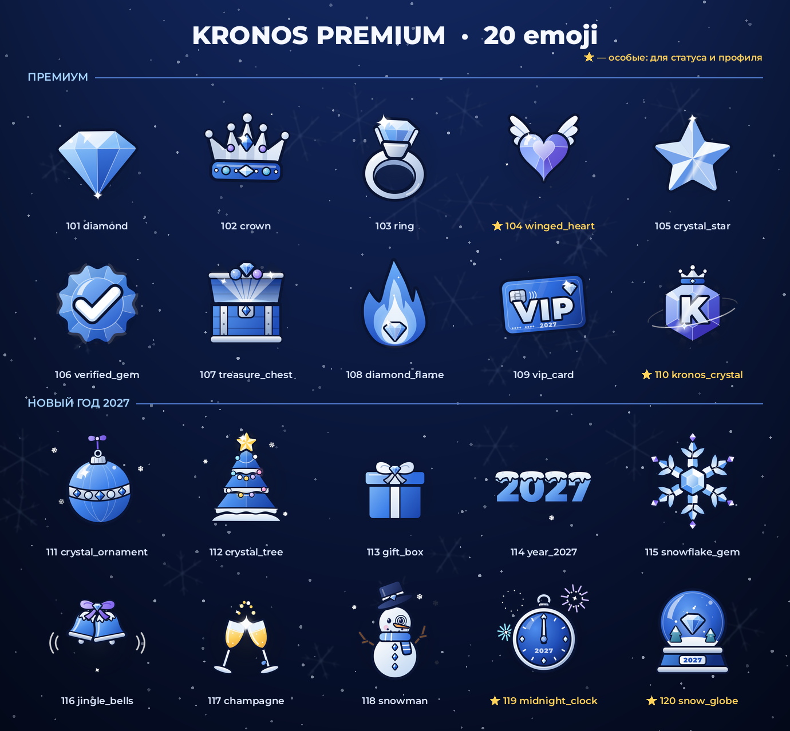

# KRONOS PREMIUM · 20 emoji



Премиальный набор эмодзи для Telegram в стиле **KRONOS STAFF**: 10 премиальных
(бриллианты, корона, VIP…) и 10 новогодних. Отмеченные ★ — особые, сделаны так,
чтобы красиво смотреться как эмодзи-статус в профиле.

Анимация всех эмодзи сразу: [`dist/preview/sheet.mp4`](dist/preview/sheet.mp4).

## Что внутри

| Папка | Что это |
|---|---|
| `dist/tgs/` | анимированные эмодзи `.tgs`: Lottie 512×512, 60 fps, 3 с, бесшовная петля, 2.5–12.4 КБ (лимит Telegram 64 КБ) |
| `dist/png/100/` | статичные эмодзи 100×100 PNG (размер Telegram для статичных эмодзи) |
| `dist/png/512/` | те же картинки 512×512 (стикеры, превью) |
| `dist/preview/` | общий лист `sheet.png` и видео `sheet.mp4` |
| `dist/manifest.json` | названия и эмодзи-привязки |

## Список

| № | Файл | Название | Эмодзи |
|---|---|---|---|
| 101 | `diamond` | Бриллиант | 💎 |
| 102 | `crown` | Алмазная корона | 👑 |
| 103 | `ring` | Кольцо с бриллиантом | 💍 |
| 104 ★ | `winged_heart` | Крылатое сердце | 💖 |
| 105 | `crystal_star` | Кристальная звезда | ⭐ |
| 106 | `verified_gem` | Алмазная галочка | ✅ |
| 107 | `treasure_chest` | Сундук с сокровищами | 🧰 |
| 108 | `diamond_flame` | Алмазное пламя | 🔥 |
| 109 | `vip_card` | VIP-карта | 💳 |
| 110 ★ | `kronos_crystal` | Кристалл KRONOS | 💠 |
| 111 | `crystal_ornament` | Хрустальный шар | 🎄 |
| 112 | `crystal_tree` | Хрустальная ёлка | 🎄 |
| 113 | `gift_box` | Подарок | 🎁 |
| 114 | `year_2027` | 2027 | 🎆 |
| 115 | `snowflake_gem` | Снежинка-алмаз | ❄️ |
| 116 | `jingle_bells` | Колокольчики | 🔔 |
| 117 | `champagne` | Бокалы | 🥂 |
| 118 | `snowman` | Снеговик-джентльмен | ☃️ |
| 119 ★ | `midnight_clock` | Полночь | 🕛 |
| 120 ★ | `snow_globe` | Снежный шар | 🔮 |

## Как загрузить в Telegram

1. Откройте [@Stickers](https://t.me/Stickers) и отправьте `/newemojipack`.
2. Выберите тип: «Анимированные» (файлы из `dist/tgs/`) или «Статичные» (файлы из `dist/png/100/`).
3. Отправьте название набора, затем по очереди: файл → эмодзи из таблицы выше.
4. `/publish` → иконка набора (можно `/skip`) → короткое имя для ссылки.

## Пересборка

```bash
python3 -m venv .venv && .venv/bin/pip install -r requirements.txt
.venv/bin/python tools/build.py      # всё в dist/ (+ zip-архив, он не коммитится)
.venv/bin/python tools/validate.py   # проверка требований Telegram
```

Каждый эмодзи — отдельный модуль `kemoji/emoji/eNNN_<name>.py` с функцией `build()`;
общие детали (огранка камней, блики, искры, снег) лежат в `kemoji/gems.py` и
`kemoji/style.py`. Для отладки: `tools/preview.py 101 102` рисует раскадровку,
`tools/seamdiff.py 115` показывает разницу между первым и последним кадром.

`tools/validate.py` для каждого `.tgs` проверяет: размер ≤ 64 КБ, холст 512×512,
60 fps, ≤ 180 кадров; отсутствие запрещённых Telegram функций (маски, маты,
выражения, эффекты, star shapes, градиентные обводки, repeater, merge paths, skew,
3D, картинки, текстовые слои); что ни в одном кадре ничего не касается края холста;
что петля бесшовная (кадр 180 совпадает с кадром 0). Дополнительно прогоняется
валидатор TGS из `python-lottie`.

## Шрифт

Цифры и буквы (`2027`, `VIP`, `K`) — векторные контуры Montserrat Black
(SIL Open Font License 1.1), лицензия в `assets/fonts/OFL.txt`; этот же шрифт
используется для подписей на превью.
